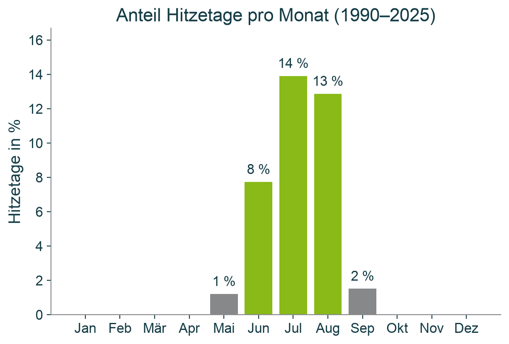
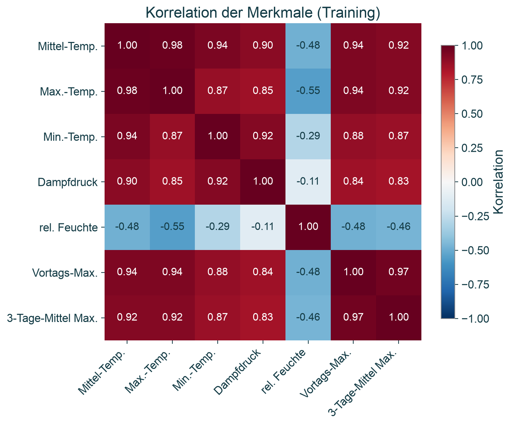
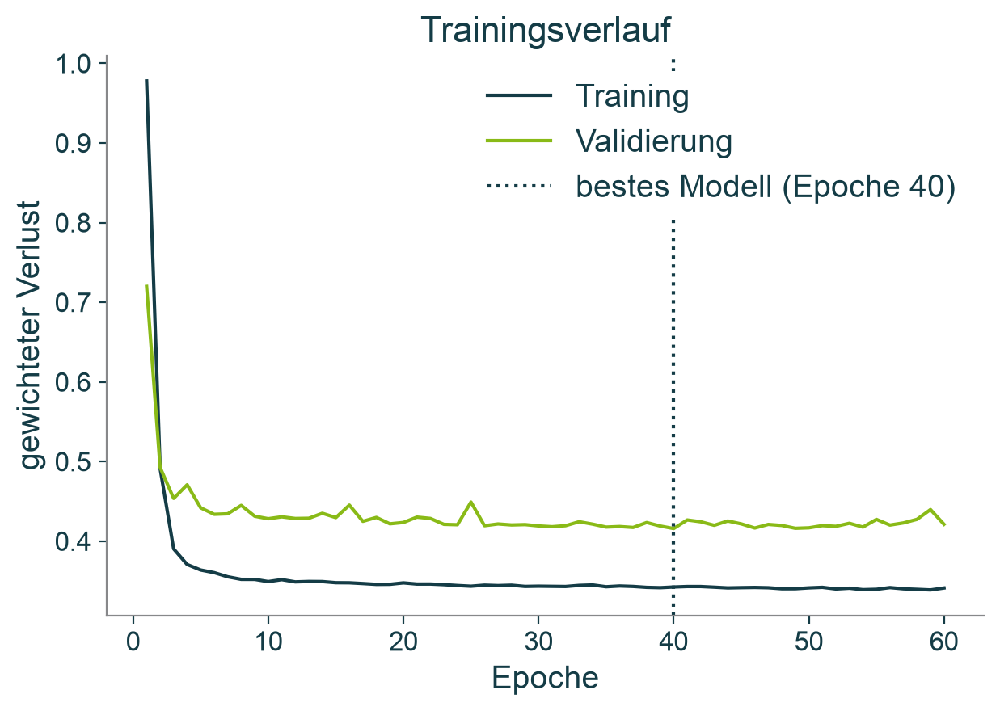

# Part II — Case study {-}

# 9 Data and task

> **In short.** Five DWD stations, 1990–2025, 64 668 station-days. Task: from today's weather, predict whether
> tomorrow reaches 30 °C. Only 3.15 % of the days are positive, 93 % of them in June–August. The five
> temperature features correlate at 0.87–0.98.

## 9.1 Source and prediction task

The data are daily station observations of the Deutscher Wetterdienst [DWD] for Berlin, Frankfurt, Hamburg,
Köln and München, as shipped with the earlier project *heatrisk-deutschland* (commit `9974c0e`). That project's
loader, target, features and split were audited and reused unchanged, so the MLP can be compared with its
baselines on exactly the same test days. The audit found no date gaps or duplicates, no remaining `-999`
missing-value codes and no leakage; the München series starts on 17 May 1992.

The prediction is made at the end of day $t$. The target is 1 if the maximum temperature of day $t+1$ at the
same station is at least 30.0 °C ("heat day", *Hitzetag*).

## 9.2 Features

All seven features are known at the end of day $t$; lags and the rolling window are computed per station, and
the rolling window excludes today.

| Code | Meaning | Label in the figures |
|---|---|---|
| TMK | daily mean temperature (°C) | Mittel-Temp. |
| TXK | daily maximum temperature (°C) | Max.-Temp. |
| TNK | daily minimum temperature (°C) | Min.-Temp. |
| VPM | vapour pressure (hPa) | Dampfdruck |
| UPM | relative humidity (%) | rel. Feuchte |
| TXK_lag_1 | maximum temperature of day $t-1$ | Vortags-Max. |
| TXK_rolling_3 | mean of the maximum temperatures of $t-1$, $t-2$, $t-3$ | 3-Tage-Mittel Max. |

## 9.3 Class balance and season

| Split | Period | Rows | Heat days | Rate |
|---|---|---:|---:|---:|
| Training | 04.01.1990 – 31.12.2020 | 55 543 | 1 682 | 3.03 % |
| Validation | 01.01.2021 – 31.12.2023 | 5 475 | 219 | 4.00 % |
| Test | 01.01.2024 – 30.12.2025 | 3 650 | 135 | 3.70 % |
| All | | 64 668 | 2 036 | 3.15 % |

{width=55%}

Two consequences. Accuracy is useless as a metric (a model that always says "no" is 96 % accurate), so the
evaluation uses precision, recall, F1, the area under the precision–recall curve (PR-AUC) and the confusion
matrix. And a background sample drawn from the whole year consists mostly of cold days, which will matter for
the base value (Section 11.1).

## 9.4 Correlated features

{width=60%}

The five temperature features correlate at 0.87–0.98 (mean and maximum temperature 0.98; previous-day maximum
and 3-day mean 0.97); vapour pressure correlates with them at 0.83–0.92; relative humidity is negatively
correlated (−0.11 to −0.55). As discussed in Section 5.3, the attribution for "it is hot" will be shared
among these features, and the interventional value function will evaluate the model on combinations that do
not occur.

## 9.5 Split and preprocessing

The split is chronological and never shuffled across time. Missing values (at most 26 rows per split, mostly
vapour pressure and humidity) are imputed with training means, and all features are standardised with training
means and standard deviations. The test period was used once, for the final evaluation; every choice (epochs,
threshold, background) uses training or validation data only.

# 10 Model and training

> **In short.** A 7 → 16 → 8 → 1 ReLU network with 273 parameters reaches F1 0.516 and PR-AUC 0.431 on
> 2024–2025, slightly better than the random forest of the source project and much more precise than its
> logistic regression.

**Training.** Binary cross-entropy on the logit (`BCEWithLogitsLoss`) with the positive class weighted by
$n_\text{neg}/n_\text{pos} = 32$ on the training data; Adam with learning rate $10^{-3}$, batch size 256, at most
300 epochs, early stopping on the validation loss (patience 20; best epoch 40); seed 42. The decision threshold
is the one with the best F1 on the validation period (grid 0.05–0.95), which is 0.9. The class weight shifts all
probabilities upwards, which explains the high threshold; the probabilities are not calibrated.

{width=55%}

**Results on the test period** (3 650 station-days, 135 heat days):

| Model | Precision | Recall | F1 | PR-AUC |
|---|---:|---:|---:|---:|
| Persistence (today ≥ 30 °C) | 0.415 | 0.415 | 0.415 | 0.194 |
| Logistic regression (source project) | 0.252 | 0.956 | 0.399 | 0.411 |
| Random forest (source project) | 0.429 | 0.607 | 0.503 | 0.428 |
| **MLP** | **0.421** | **0.667** | **0.516** | **0.431** |

The MLP finds 90 of the 135 heat days with 124 false alarms (confusion matrix: 3 391 true negatives, 124 false
positives, 45 false negatives, 90 true positives). Without the class weight it finds 15 fewer heat days with a
similar PR-AUC (0.448, F1 0.502); the weight mainly moves the decision threshold. The model is good enough to be
worth explaining, and simple enough that its explanations can be checked exactly — which was the goal.
