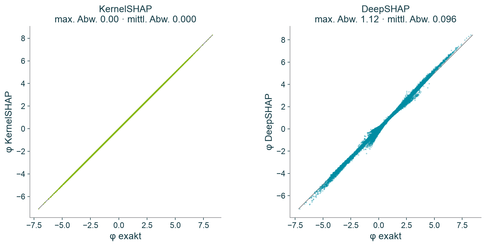
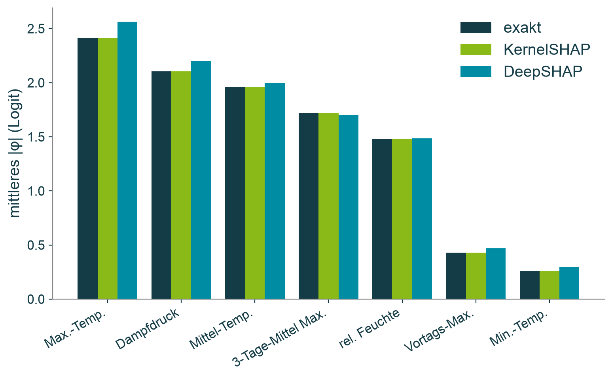
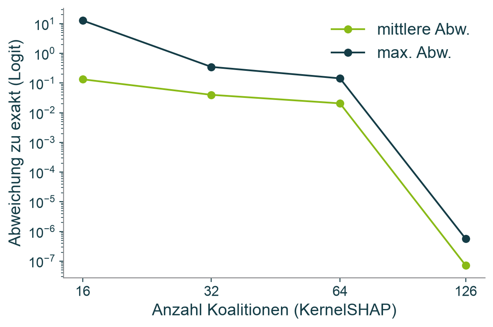
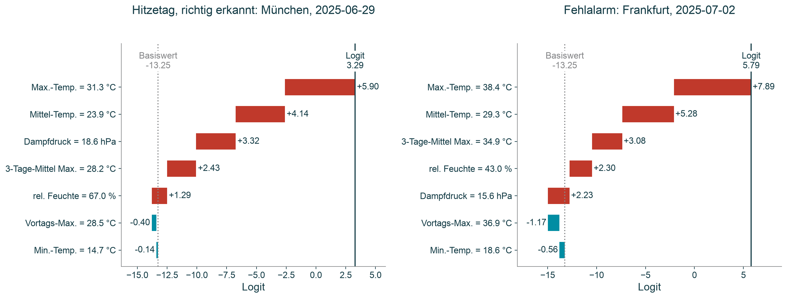
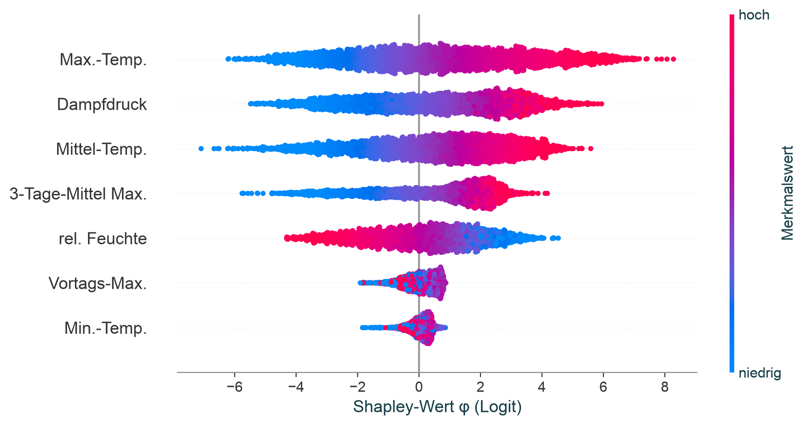
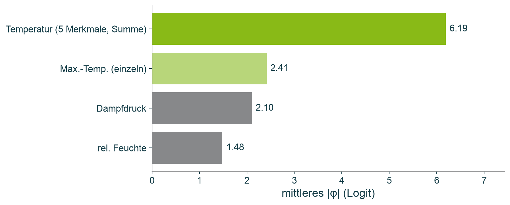
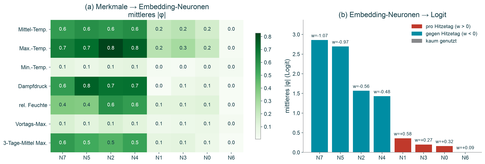
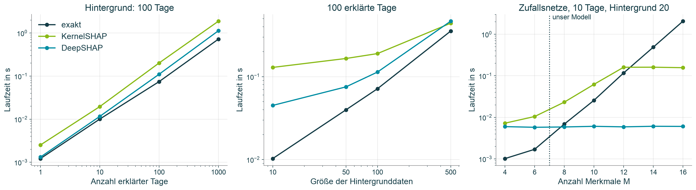
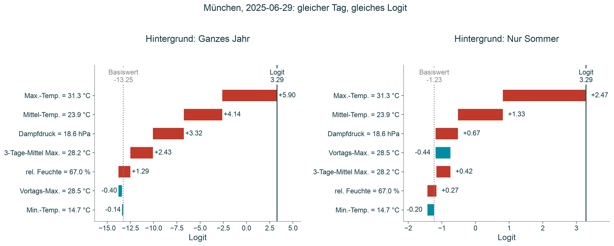
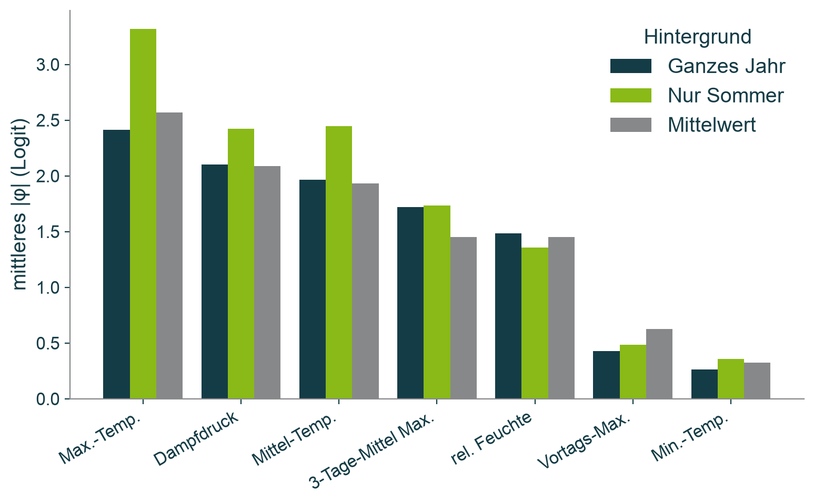

# 11 Shapley values on the logit

> **In short.** Exact Shapley values for all 3 650 test days take 3.1 s. Default KernelSHAP reproduces them to
> $10^{-6}$; DeepSHAP keeps the sum but deviates by 6.5 % of the mean attribution on average. Temperature
> dominates, but is split over five correlated features.

**Setup** (identical for all methods): explained output = logit; interventional value function; background =
100 random training days (seed 42), shared by all methods; base value $\varphi_0$ = mean logit over these days.

## 11.1 Exact values and the base value

The own implementation evaluates all 128 coalitions for every test day: $3650 \times 128 \times 100 \approx
46.7$ million model evaluations in 3.1 s on an Apple M1 laptop. The efficiency gap
$|\varphi_0 + \sum_i\varphi_i - \text{logit}(x)|$ is at most $7.6 \cdot 10^{-6}$ (float32 rounding).

The base value is $\varphi_0 = -13.25$. It is so low because most background days are winter days with
logits around −25. It must not be converted into a probability: it is the mean of logits, not the logit of a
mean probability (Section 2.2).

## 11.2 KernelSHAP and DeepSHAP against the exact values

| | max. abs. deviation from exact | mean abs. deviation | same top feature as exact | runtime, 3 650 days |
|---|---:|---:|---:|---:|
| Exact (own code) | — | — | — | 3.1 s |
| KernelSHAP (default) | $1.1 \cdot 10^{-6}$ | $7 \cdot 10^{-8}$ | 100 % of days | 6.8 s |
| DeepSHAP | 1.12 | 0.096 (6.5 % of mean $\lvert\varphi\rvert$) | 93.6 % of days | 4.2 s |

{width=85%}

**KernelSHAP is exact here**, as predicted in Section 6.2: its default budget (2 062) exceeds the 126
non-trivial coalitions, so nothing is sampled. **DeepSHAP** satisfies efficiency on every day but distributes
the gap differently. Its largest deviations occur on days where ReLU neurons switch between the background days
and the instance — the situation of Exercises 14 and 16. Globally the difference is small: the mean absolute
attributions of the three methods are almost the same, and the ranking of the features does not change.

{width=60%}

## 11.3 How fast does KernelSHAP converge?

To make the approximation visible, KernelSHAP was run with fewer coalitions on 300 random test days
(`l1_reg=False`):

| Coalitions | 16 | 32 | 64 | 126 (all) |
|---|---:|---:|---:|---:|
| mean abs. deviation from exact | 0.134 | 0.040 | 0.021 | $7 \cdot 10^{-8}$ |

{width=55%}

With 16 coalitions for 7 unknowns the weighted regression is not only inaccurate but **unstable**: on three
machines the mean deviation was 0.134, 0.142 and 0.149, and the maximum deviation varied between 8 and 14
(Section 14.2). From 32 coalitions on, results were identical across machines.

## 11.4 Two days explained

**München, 29 June 2025** (logit 3.29, probability 0.96, next day indeed ≥ 30 °C). Maximum temperature 31.3 °C
contributes +5.90, mean temperature +4.14, vapour pressure +3.32, the 3-day mean +2.43, relative humidity
+1.29; the previous day's maximum (−0.40) and the minimum temperature (−0.14) pull slightly down. The values sum
to $3.29 - (-13.25) = 16.54$. DeepSHAP gives the same sum with a different split: maximum temperature +6.07,
vapour pressure +3.62, previous-day maximum −0.78, minimum temperature −0.48.

**Frankfurt, 2 July 2025** — the most confident false alarm (38.4 °C, logit 5.79, probability 0.997; the next
day reached only 27.5 °C). The explanation shows nothing unusual: the model reacts to today's heat (maximum
temperature +7.89, mean temperature +5.28) exactly as on the München day. The cooling came from a weather change
that the seven features cannot show — there is no information about pressure, wind or fronts. The explanation
does not reveal a "bug" in the model; it reveals the limits of its inputs.

**Correlated features, opposite signs.** On single days correlated features receive opposite signs, e.g.
Frankfurt, 1 July 2025: maximum temperature +8.07, previous-day maximum −1.07. Such signs describe how the model
trades the two inputs off against each other; they do not mean that yesterday's heat makes tomorrow cooler.

## 11.5 Global view

{width=80%}

Ranking by mean $|\varphi|$ (logit units): maximum temperature 2.41, vapour pressure 2.10, mean temperature
1.96, 3-day mean 1.72, relative humidity 1.48, previous-day maximum 0.43, minimum temperature 0.26. High
temperatures and high vapour pressure push towards "heat day", high humidity pushes away from it.

{width=60%}

Summing the five temperature features per day before taking the absolute value gives a mean of 6.19 —
two and a half times the strongest single feature. Because Shapley values are additive, such group values are
legitimate; for correlated features they are the more honest summary (Section 5.3).

# 12 Shapley values on the embedding

> **In short.** Four neurons with negative output weights are active on more than 90 % of all days and dominate
> the logit. Before most heat days they switch off: the network recognises heat mainly by "normal weather"
> neurons turning off.

Both readings of Section 7 were computed exactly — reading (a) with 128 coalitions and 8 outputs at once,
reading (b) with all $2^8 = 256$ coalitions — and compared with the closed form, KernelSHAP and DeepSHAP.

| Check | Value |
|---|---|
| (a) efficiency gap | $3.6 \cdot 10^{-15}$ |
| (b) base value | −13.25 (same as for the input features, Section 7.1) |
| (b) exact vs. closed form $w_k(h_k - \overline{h_k})$ | $1.3 \cdot 10^{-6}$ |
| (a) KernelSHAP / DeepSHAP, max. deviation | $2.8 \cdot 10^{-5}$ / 0.41 |
| (b) KernelSHAP / DeepSHAP, max. deviation | $3.0 \cdot 10^{-5}$ / $2.9 \cdot 10^{-6}$ |

DeepSHAP is exact in reading (b) because the head is linear, and approximate in reading (a) because of the
ReLU layers — exactly as predicted in Sections 6.3 and 7.1.

| Neuron | weight to logit | active (all test days) | active (day before a heat day) | mean $\lvert\varphi\rvert$ (b) | strongest input (a) |
|---|---:|---:|---:|---:|---|
| N7 | −1.07 | 92 % | 25 % | 2.86 | Max.-Temp. |
| N5 | −0.97 | 91 % | 27 % | 2.69 | Dampfdruck |
| N2 | −0.56 | 97 % | 60 % | 1.57 | Max.-Temp. |
| N4 | −0.48 | 96 % | 50 % | 1.43 | Max.-Temp. |
| N1 | +0.58 | 36 % | 100 % | 0.36 | Max.-Temp. |
| N3 | +0.27 | 35 % | 100 % | 0.20 | Max.-Temp. |
| N0 | +0.32 | 31 % | 99 % | 0.16 | Max.-Temp. |
| N6 | +0.09 | 19 % | 0 % | 0.01 | (practically unused) |

**Interpretation.** The four neurons with negative weights (N7, N5, N2, N4) fire on almost every day; their
activity keeps the logit low ("normal weather"). Before heat days they mostly switch off, and the logit rises.
Three neurons with positive weights fire before almost every heat day but contribute little because their
weights are small. N6 is practically unused. Reading (a) shows what the important neurons react to:
temperatures, vapour pressure and humidity, hardly minimum temperature and the previous-day maximum — the same
picture as on the logit, now resolved by neuron. Together the two readings make the embedding interpretable;
reading (b) alone would only give neuron numbers.

These neuron roles belong to *this* trained network. Another seed would produce other neurons; the stable
statement is the mechanism ("heat = suppression of the normal-weather neurons"), not the neuron indices.

# 13 Runtime

> **In short.** All methods scale linearly with the number of explained days and with the background size.
> For seven features the exact computation is the fastest method. Its cost doubles with every feature and
> overtakes KernelSHAP between 12 and 14 features; DeepSHAP is practically independent of the number of features.

Wall-clock time of the explanation only (explainer construction < 1 ms), one warm-up call, median of repeated
runs; Apple M1, 8 GB RAM, PyTorch using 4 threads. Experiments A ($N = 100$) and B (100 explained days) use the trained model, experiment C (10 days,
$N = 20$) untrained networks $M$-16-8-1 with random inputs, to show the growth in $M$ that a 7-feature model cannot show.

| A: explained days $B$ | 1 | 10 | 100 | 1000 |
|------------------------|------:|------:|------:|------:|
| exact | 0.001 s | 0.010 s | 0.075 s | 0.723 s |
| KernelSHAP | 0.003 s | 0.020 s | 0.202 s | 1.885 s |
| DeepSHAP | 0.001 s | 0.012 s | 0.111 s | 1.132 s |

| B: background size $N$ | 10 | 50 | 100 | 500 |
|------------------------|------:|------:|------:|------:|
| exact | 0.010 s | 0.040 s | 0.072 s | 0.355 s |
| KernelSHAP | 0.129 s | 0.166 s | 0.190 s | 0.441 s |
| DeepSHAP | 0.045 s | 0.075 s | 0.114 s | 0.467 s |

| C: features $M$ | 4 | 6 | 8 | 10 | 12 | 14 | 16 |
|----------------------|------:|------:|------:|------:|------:|------:|------:|
| coalitions $2^M$ | 16 | 64 | 256 | 1 024 | 4 096 | 16 384 | 65 536 |
| exact | 0.001 s | 0.002 s | 0.007 s | 0.026 s | 0.117 s | 0.489 s | 2.064 s |
| KernelSHAP | 0.007 s | 0.010 s | 0.023 s | 0.062 s | 0.161 s | 0.161 s | 0.157 s |
| DeepSHAP | 0.006 s | 0.006 s | 0.006 s | 0.006 s | 0.006 s | 0.006 s | 0.006 s |

**Predictions versus measurements** (Section 8):

- **P1 ✓** All three methods are linear in the number of explained days; the time per day is constant.
- **P2 partly ✓** Exact and DeepSHAP are linear in $N$. KernelSHAP is dominated by its per-day overhead (setting
  up coalitions, the weighted regression) up to about 100 background days and only then grows with $N$.
- **P3 ✗/✓** The row counts suggested "exact ≈ KernelSHAP > DeepSHAP". Measured: exact < DeepSHAP < KernelSHAP.
  The own exact code evaluates the coalitions of 25 days at once (320 000 rows in one forward pass), whereas
  both library explainers loop over the days in Python. The row count is the same; the number of calls is not.
- **P4 ✓** Exact doubles with every feature (×4 per two features in table C). KernelSHAP follows $2^M$ until its
  budget no longer covers all coalitions, then stays flat at ≈ 0.16 s — from that point on it is an
  approximation. DeepSHAP stays flat at 6 ms.
- **P5 ✓** For a 273-parameter network the per-call overhead dominates: KernelSHAP is only about 1.6 times slower
  than DeepSHAP on all test days, not orders of magnitude.

The common summary "KernelSHAP is slow, DeepSHAP is fast" therefore does not hold for small models. What decides
the runtime is the number of features: exact computation is the best choice up to about a dozen features, and
DeepSHAP is the only one of the three whose cost does not depend on $M$ at all. Absolute times are machine
dependent and only comparable within one run.

# 14 Background sensitivity and reproducibility

## 14.1 The background decides the question

> **In short.** For the same day and the same logit, a summer-only background makes the attributions less than
> half as large. The ranking of the features stays similar. Every explanation must name its background.

Exact Shapley values for all test days with three backgrounds from the training period:

| Background | base value | Max.-T. | Dampfdr. | Mittel-T. | 3-Tage | rel. F. | Vortag | Min.-T. |
|------------------------|-----:|-----:|-----:|-----:|-----:|-----:|-----:|-----:|
| whole year (100 days) | −13.25 | 2.41 | 2.10 | 1.96 | 1.72 | 1.48 | 0.43 | 0.26 |
| summer only (100 days) | −1.23 | 3.32 | 2.42 | 2.44 | 1.74 | 1.36 | 0.48 | 0.36 |
| training mean (1 row) | −8.82 | 2.57 | 2.09 | 1.93 | 1.45 | 1.45 | 0.62 | 0.33 |

(mean $|\varphi|$ over the test days, logit units; summer = June–August training days)

For München, 29 June 2025, the maximum temperature contributes +5.90 against the whole year but only +2.47
against summer days; mean temperature +4.14 → +1.33, vapour pressure +3.32 → +0.67. Both explanations are
correct — they answer different questions: "why is this day more heat-prone than an average day of the year?"
versus "… than an average summer day?". Globally the summer background makes the attributions *larger*. This is
consistent with efficiency: 80 % of the test-day logits lie below the summer base value of −1.23 (median −8.4),
so on most days the gap the Shapley values must add up to is wider than against the whole-year base value.

**Sampling noise.** Ten random 100-day backgrounds (seeds 0–9) give Shapley values whose standard deviation is
about 11.5 % of the mean $|\varphi|$. The background is therefore not only a conceptual choice but also a source
of random variation of the same order as the DeepSHAP approximation error (6.5 %).

{width=60%}

## 14.2 Reproducibility

The complete pipeline (tests, dataset analysis, training and all Shapley analyses) was rerun from a fresh clone
on a Linux machine and compared with the committed results produced on an Apple M1:

| Result | fresh run vs. committed |
|---|---|
| tests | 21 passed |
| dataset summary, MLP metrics and confusion matrix | identical |
| exact Shapley values, 3 650 days × 7 features | max. difference $3.5 \cdot 10^{-6}$ |
| KernelSHAP/DeepSHAP deviations, background study, embeddings | max. difference < $10^{-6}$ |
| KernelSHAP convergence with 16 coalitions | mean deviation 0.142 vs. 0.134 (unstable, Section 11.3) |

Everything is reproducible up to float32 rounding, with the single exception of KernelSHAP with far too few
coalitions — itself a finding.
